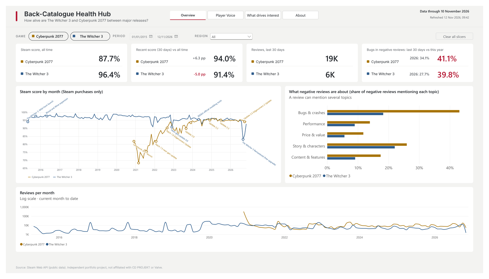
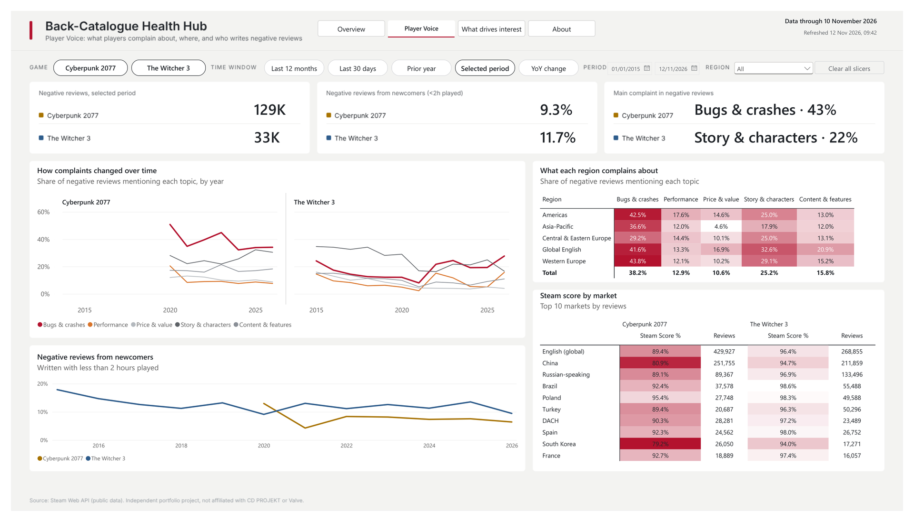
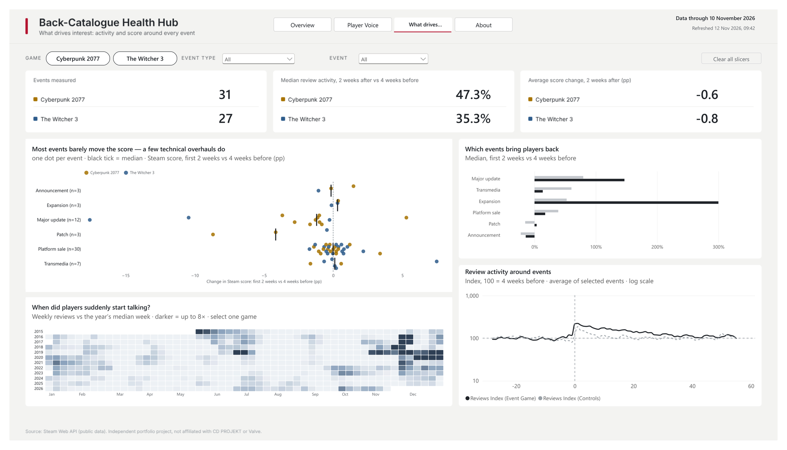
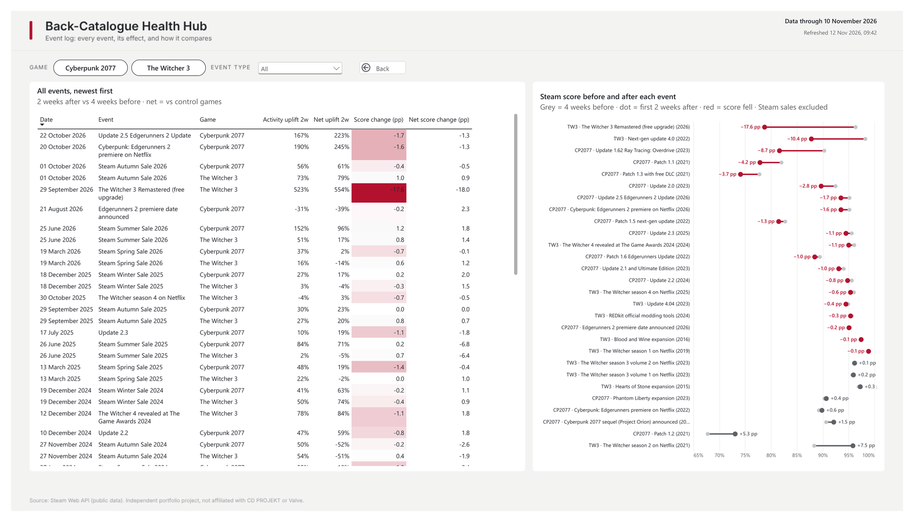

# CD PROJEKT Back-Catalogue Health Hub

**How alive are The Witcher 3 and Cyberpunk 2077 between major releases, and which events move player interest and sentiment?**

An end-to-end analytics project on public Steam data: automated collection, a tested PostgreSQL + dbt warehouse, and a Power BI semantic model with row- and object-level security, a calculation group and Best Practice Analyzer checks in CI, all versioned in Git.

> Independent portfolio project based on public data. Not affiliated with or endorsed by CD PROJEKT or Valve. No company logos or game assets are used.



## Key findings

1. **Technical overhauls of an old game cost the most score; content and TV do not.** The five largest drops in Steam score (first 2 weeks vs the 4 weeks before) are all technical releases: The Witcher 3 Remastered (−17.6 pp), The Witcher 3 next-gen update 4.0 (−10.4 pp), Cyberpunk 2077 Update 1.62 Ray Tracing: Overdrive (−8.7 pp), Patch 1.1 (−4.2 pp) and Patch 1.3 (−3.7 pp). Expansions and Netflix premieres bring players back without that cost: Cyberpunk: Edgerunners +457% review activity net of the control games with +0.6 pp score, Phantom Liberty +300% with +0.4 pp.
2. **The Witcher 3 Remastered (29 Sep 2026) is both the second-largest audience surge and by far the largest score drop.** Review activity rose 6.2× in the first two weeks (+554% net of the control games), while the score fell 17.6 pp. Six weeks later the last-30-day score is 91.4% as of 11 November 2026, 5.0 pp below the game's all-time 96.4%. Bugs are mentioned in 40% of its negative reviews in the last 30 days as of 11 November 2026, up from 12% in 2020, 19% in 2025 and 28% in 2026 to date. ([analysis](analysis/witcher3_remaster_findings.md))
3. **Cyberpunk 2077's recovery is visible in the data.** Bugs were mentioned in 51% of negative reviews in 2020 and 34% in 2025–2026. The last-30-day score is 94.0% as of 11 November 2026, 6.3 pp above the all-time 87.7%. The largest single lift in activity came from Update 2.0 (+595% net), not from a sale.
4. **Markets differ more for Cyberpunk 2077 than for The Witcher 3.** Among markets with at least 10,000 reviews, Cyberpunk 2077 ranges from 79.2% in South Korea and 80.9% in China to 95.4% in Poland, a 16 pp spread; The Witcher 3 ranges only from 94.0% (South Korea) to 98.6% (Brazil). Bugs dominate negative reviews in Western Europe (44%) and the Americas (43%), while Central & Eastern Europe mentions bugs less (29%) and story as often (25%).

Effects are measured against the game's own 4 weeks before each event and, where shown as *net*, against a fixed control group (Baldur's Gate 3, ELDEN RING, Red Dead Redemption 2) on the same days.

## Report

| Page | Question it answers |
| --- | --- |
| **Overview** | Score, recent score vs all time, review volume and the bugs share, per game; score and review volume over time with key events |
| **Player Voice** | What players complain about, how that changed, which regions and markets are most critical, and how many negative reviews come from newcomers |
| **What drives interest** | Which event types move the score and which bring players back; activity around any event vs the control group; weekly activity heat map |
| **Event log** | Hidden page, opened by drill-through from the event charts: every measured event with activity and score change, gross and net |
| **About** | Purpose, KPI dictionary, data and method, limitations, colour rules |

**Player Voice**



**What drives interest**



**Event log**



## Architecture

```
Steam Web API ──► GitHub Actions ──► CSV in Git ──► PostgreSQL ──► dbt ──► Power BI
  players (hourly)   cron-job.org       raw, append-only   raw          staging      semantic model (PBIP / TMDL)
  reviews (daily)    trigger            no review text                  intermediate RLS + OLS, calc group
                                                                        marts        BPA in CI
```

| Layer | What it does |
| --- | --- |
| Collection | Hourly concurrent players and full review history for 5 games (2 CDPR + 3 control). Review text and author IDs are never stored: topics (bugs, performance, price, story, content) are tagged by a versioned keyword dictionary in 10 languages while the text is in memory. |
| Warehouse | Idempotent loader (SHA-256 per file), dbt layers raw → staging → intermediate → marts; 80+ data tests including reconciliation of every review, grain checks and a counter wrap-around guard. |
| Event study | `fct_event_window` (every event on a −28…+55 day axis) and `fct_event_impact` (uplift vs 4 weeks before and difference-in-differences vs the control group); NULL when the data cannot support a number. |
| Semantic model | Star schema with 14 tables and 13 single-direction relationships; 34 measures in display folders, every object described; a `Time Window` calculation group (last 30 days, last 12 months, prior year, YoY); measures reconciled against SQL to the last digit. |
| Security | Dynamic RLS on region from a tested, version-controlled access table; OLS hides technical collection columns; a read-only database role for Power BI. |
| Quality gates | Tabular Editor Best Practice Analyzer runs on every pull request that touches the model (0 violations, documented exceptions); report files are validated after scripted edits. |

## What this project demonstrates

| Requirement | Where |
| --- | --- |
| Semantic models and DAX | Star schema, calculation group with pass-through for measures that own their time window, rolling 30-day score, difference-in-differences event measures, text measures (main complaint), measure-driven conditional formatting |
| Platform management, security, refresh | Dynamic RLS by region, OLS, read-only `powerbi_reader` role with grants re-applied by dbt, one-command refresh (`run_pipeline.ps1`), data-freshness stamp on every page |
| SQL (PostgreSQL) and data modelling | dbt models, window functions, generated date spines, event windows, control-group comparisons |
| Git workflow | Power BI project as PBIP/TMDL/PBIR, feature branches and pull requests with squash merge, BPA as a CI check, scheduled collection in GitHub Actions |
| Shared KPIs and standards | KPI dictionary in the report, measure descriptions, theme as a file, a written colour rule (games have fixed colours; red only marks a problem) |
| Data quality | 80+ dbt tests, DAX vs SQL reconciliation, topic dictionary checked by hand, a full report and model inventory (`docs/report_inventory.md`) |
| Report design | Five pages on one grid, drill-through, custom Vega-Lite visuals (Deneb) for event distributions, before/after charts and a weekly heat map |

## Data at a glance

4.88 million reviews for the five games (1.91 million for the two CDPR games) from May 2015 · 51 events in the calendar, 58 event × game impacts measured · 31 languages mapped to markets and regions · hourly player counts since 21 October 2026.

## Run it

```powershell
git clone https://github.com/Iryna-Petruk/steam-player-collector
cd steam-player-collector
python -m venv .venv; .\.venv\Scripts\Activate.ps1
pip install -r requirements.txt
# PostgreSQL connection from PGHOST, PGPORT, PGUSER, PGPASSWORD, PGDATABASE
.\run_pipeline.ps1          # git pull -> load raw -> dbt build
```

Then open `CDPR_Health_Hub.pbip` in Power BI Desktop and refresh. Technical details of the collectors, warehouse and tests: [docs/pipeline.md](docs/pipeline.md).

## Limitations

Steam only (no consoles, GOG or Epic) · players in offline mode are not counted · player history starts on 21 October 2026, so player charts will follow once there is enough history; reviews go back to 2015 · keyword topics do not understand sarcasm or negation · the event calendar is maintained by hand, with a source for every event.
